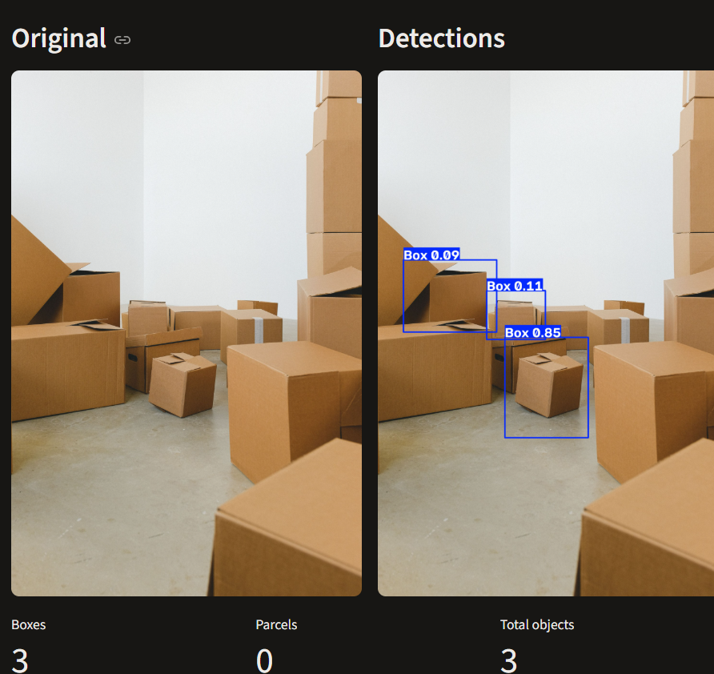
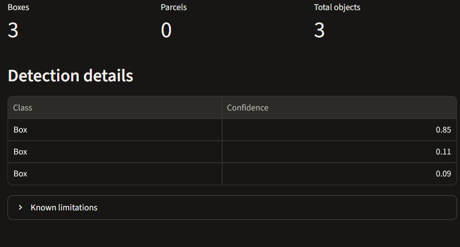

# 📦 Parcel & Box Detector

A small AI app that looks at a photo and finds **boxes** and **parcels** in it. It draws a box around each one, labels it, and counts them. I built it with a custom-trained YOLOv8 model and a Streamlit web app.

**Try it here:**
- Streamlit Cloud: `https://logistics-parcel-detection-ftbtdcd2cfwlkgnoyjovod.streamlit.app/`
- Hugging Face Space: `PASTE-HUGGING-FACE-LINK-HERE`




## Why this project?

Warehouses and delivery hubs handle a huge number of packages. Counting them by hand is slow and people make mistakes. This app does a quick automatic count from a photo.

It detects two things:
- **Box**: cardboard boxes
- **Parcel**: parcels like white plastic mailer bags

## Dataset

I used the public [Parcels and Boxes dataset on Roboflow](https://universe.roboflow.com/abl-okoo2/parcels-and-boxes-dv7sg) (CC BY 4.0, credit to Roboflow user `abl-okoo2`). It has 5,988 images, already split 70/20/10.

| Split | Images | Boxes | Parcels |
|---|---|---|---|
| Train (70%) | 4,194 | 6,645 | 4,907 |
| Validation (20%) | 1,190 | 1,797 | 1,357 |
| Test (10%) | 604 | 996 | 736 |

One fix was needed: the labels were a mix of rectangles and polygons. `prep_dataset.py` turns every polygon into a rectangle so YOLO can read them all the same way.

The dataset is about 480 MB, so it is not in this repo. Download it from the link above.

## Model

I used **YOLOv8s (small)**. Here is why:
- The nano version is fast but too weak for photos with lots of overlapping parcels.
- The medium and large versions are slower to train and not needed for just two classes.
- The small version is accurate enough, trains in about an hour on a free Colab GPU, and is only about 22 MB, so it is easy to deploy.

Training setup: 40 epochs (stops early if it stops improving), image size 640, batch size 16, on a Google Colab T4 GPU.

## Results

Final scores on the **test set** (604 images the model never saw while training):

| Metric | Score |
|---|---|
| mAP@50 | 0.955 |
| mAP@50-95 | 0.871 |
| Precision | 0.929 |
| Recall | 0.899 |

It runs at about 10.7 ms per image on a T4 GPU. On the validation set it got 98% of boxes and 97% of parcels right, with only about 1% mix-ups between the two. Training and validation loss went down together, so it didn't overfit.

## Where it fails

I also tried it on stock photos from Pexels with backgrounds it hadn't seen. It worked well on some (like white parcel bags on a table) but struggled on others:

- **Big, close-up boxes can be missed.** In a room full of boxes, it found only one small box. Lowering the confidence threshold didn't help, so the model simply hasn't seen enough images like that.
- **Brown padded mailers and flat envelopes are a weak spot.** The dataset's "Parcel" class is mostly white plastic bags on a conveyor belt, so brown mailers get missed or called "Box".
- **Some correct detections have low confidence** (around 0.23 to 0.36).
- **It may lean on the background.** Many Parcel photos come from one conveyor belt, and many Box photos are augmented single-box shots, so the model might partly learn the scene and not just the object.
- **The test score is probably a bit optimistic.** The dataset's augmented copies were made before splitting, and I found a few images shared between splits (9 between train and validation, 5 between train and test). Real-world performance is likely lower than 0.955.

**How to make it better:** add more varied photos (clutter, close-ups, brown mailers), re-split the data so copies of the same photo stay together, and add more classes like envelopes.

## The app

- Upload a JPG or PNG image
- See the boxes and labels drawn on the result
- Change the confidence slider to see more or fewer detections
- See how many boxes and parcels were found, plus a table with confidence scores

## What's in this repo

```
├── app.py            the Streamlit app
├── best.pt           the trained model
├── requirements.txt  packages needed
├── training.ipynb    training, testing and inference (Google Colab)
├── prep_dataset.py   fixes the dataset labels
├── screenshots/      images used in this README
└── README.md
```

## Run it on your computer

```bash
git clone https://github.com/Bhanu4994/logistics-parcel-detection.git
cd logistics-parcel-detection
python -m venv venv
venv\Scripts\activate        # Mac/Linux: source venv/bin/activate
pip install -r requirements.txt
streamlit run app.py
```

## Train it yourself

1. Download the dataset from Roboflow (YOLOv8 format).
2. Open `training.ipynb` in Google Colab and switch to a T4 GPU.
3. Run `prep_dataset.py` to fix the labels.
4. Train, test on the test split, and save `best.pt`.

## Built with

Python, YOLOv8 (Ultralytics), PyTorch, Streamlit, OpenCV, Pillow, Google Colab

## Credits

- Dataset: *Parcels and Boxes* by Roboflow user `abl-okoo2` (CC BY 4.0)
- [Ultralytics YOLOv8](https://github.com/ultralytics/ultralytics)
- Failure-test photos from [Pexels](https://www.pexels.com) (not included in this repo)